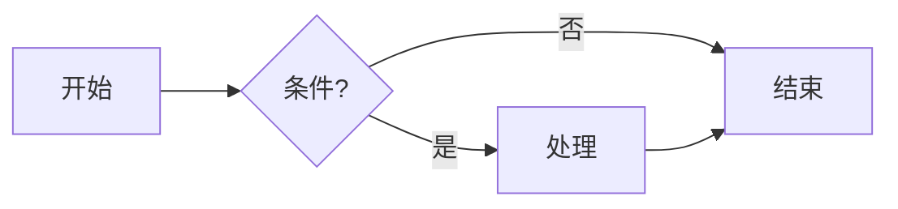

# VsMReader

> 轻量级 Markdown 阅读器 / 编辑器 · Windows · macOS · 基于 Tauri 2 + Svelte 5 · [MIT License](./LICENSE)


VsMReader 是一个**体积仅几 MB、免安装、可随身携带**的 Markdown 工具，兼顾**阅读**与**编辑**，内置语法高亮、数学公式、流程图、本地图片支持，以及一整套防丢失机制。

## 👇 下载

前往 **[Releases 发布页](https://gitee.com/coolender/vs_md_tool/releases)** 下载对应平台的程序，开箱即用，无需编译：

| 平台 | 文件 | 说明 |
|------|------|------|
| Windows | `vsmreader.exe` | 🟢 绿色单文件，双击即用，免安装 |
| Windows | `VsMReader_0.1.0_x64-setup.exe` | NSIS 安装包，双击安装 |
| macOS | `VsMReader_0.1.0_x64.dmg` | 拖入 Applications 安装 |

> Windows 绿色版若希望数据随 exe 走（U 盘便携），在 exe 同级目录新建空 `portable.txt` 即可。

---

## 从源码构建

### 环境要求

- [Node.js](https://nodejs.org/) 18+ 与 pnpm
- [Rust](https://www.rust-lang.org/) stable 工具链
- 平台依赖：
  - **Windows**：Visual Studio C++ Build Tools / WebView2
  - **macOS**：Xcode Command Line Tools

### 构建步骤

```bash
# 1. 安装依赖
pnpm install

# 2. 开发模式（热重载）
pnpm tauri dev

# 3. 生产构建（产出 exe / dmg / 安装包）
pnpm tauri build
```

构建产物在 `src-tauri/target/release/bundle/` 下。

> ⚠️ 跨平台构建限制：Windows 的 `.exe` 只能在 Windows 上构建，macOS 的 `.dmg` 只能在 macOS 上构建。如需同时发布多平台，推荐用 GitHub Actions 矩阵构建（见下文"发布流程"）。

---

## 使用手册

### 一、安装与启动

#### 方式 A：绿色版（推荐）

拿到 `vsmreader.exe` 单文件，放到任意目录，**双击即可运行**，无需安装。

- 不写注册表、不进系统目录、不驻留后台。
- 想彻底卸载？直接删掉 exe 即可，干干净净。
- 若希望"最近文件""窗口位置""设置"等数据随 exe 走（U 盘便携），在 exe 同级目录新建一个空的 `portable.txt` 文件即可——数据会存在 exe 旁的 `data/` 文件夹里。

#### 方式 B：安装版

运行 `VsMReader_0.1.0_x64-setup.exe`，按向导安装（无需管理员权限），会创建开始菜单快捷方式。

#### 让 .md 默认用 VsMReader 打开（可选，仅 Windows）

1. 启动 VsMReader，点击工具栏右侧的 **`.md`** 按钮。
2. 弹出"已注册 .md 关联"提示后，有两种方式让**双击 .md 直接用 VsMReader 打开**：
   - **方式一（推荐）**：右键任意 `.md` → 打开方式 → 选择其他应用 → 选 VsMReader → 勾选"始终使用此应用打开 .md 文件"。
   - **方式二**：设置 → 应用 → 默认应用 → 按文件类型设置 → 找到 `.md` → 选 VsMReader。
3. 以后双击任意 `.md`，会直接在 VsMReader 中打开。

> 说明：Windows 10/11 的安全机制不允许程序直接抢占"默认应用"，必须由你在系统设置里确认一次。这是 Windows 的限制，不是软件问题。点击 `.md` 按钮只是把 VsMReader 注册进"打开方式"列表，真正的"默认"仍需你手动勾选一次。
> 想取消关联？再次点击工具栏的 `.md` 按钮（此时显示为 `✓ .md`），确认即可恢复原状。

---

## 二、界面概览

```
┌──────────────────────────────────────────────────────────────────────┐
│ 新建 打开▾ 保存 另存 导出 ↶ ↷  文件名.md ●   分栏|阅读|编辑 ☾ 中 ⚙ .md │ ← 工具栏
├──────────────────────────────────────────────────────────────────────┤
│ 标签1 ●×  标签2 ×  +  ▾                                            ⚠ │ ← 标签栏
├────────────┬─────────────────────────────────────────────────────────┤
│            │                                                       │
│  大纲/文件  │            编辑区  /  预览区                          │
│  (标题树)   │                                                       │
│            │                                                       │
├────────────┴─────────────────────────────────────────────────────────┤
│ 1,234 字 · 56 行 · 约 5 分钟          C:\path\to\file.md   ← 状态栏  │
└──────────────────────────────────────────────────────────────────────┘
```

- **工具栏**：新建 / 打开（含最近文件）/ 保存 / 另存 / 导出 HTML / 撤销 ↶ / 重做 ↷ / 当前文件名与修改标记（●）/ 三模式切换 / 主题切换 / 中英文切换 / 设置 ⚙ / `.md` 关联。
- **标签栏**：多文件以标签页形式打开，互不干扰；右侧 ▾ 也是最近文件列表；`+` 新建标签。
- **侧栏**：两个标签页——**大纲**（自动提取标题树，点击跳转）和**文件**（浏览当前文档所在目录的文件树）。
- **主区域**：根据模式显示"编辑 + 预览"或其中之一。
- **状态栏**：字数 / 行数 / 阅读时间（点击切换显示项），右侧显示文件路径；自动保存失败时左侧出现红色 ⚠。

---

## 三、三种模式

顶部 `[分栏] [阅读] [编辑]` 一键切换，切换时不丢失光标和编辑状态。

| 模式 | 说明 | 快捷键 |
|------|------|--------|
| **分栏** | 左源码、右实时预览 | `Ctrl+\` |
| **阅读** | 全屏阅读，隐藏编辑区（默认模式） | `Ctrl+Shift+\` |
| **编辑** | 全屏编辑，隐藏预览区 | `Ctrl+\`（从分栏切过去） |

> 在分栏模式下，编辑器与预览滚动会自动同步。
> **每个标签独立记忆模式**：标签 A 可以是编辑模式、标签 B 可以是阅读模式，切换标签时各自恢复。

---

## 四、文件操作

| 操作 | 方式 | 快捷键 |
|------|------|--------|
| 新建 | 工具栏"新建"或标签栏 `+` | `Ctrl+N` |
| 打开 | 工具栏"打开" | `Ctrl+O` |
| 打开最近文件 | "打开"旁的 ▾，或标签栏右侧 ▾ | — |
| 保存 | 工具栏"保存" | `Ctrl+S` |
| 另存为 | 工具栏"另存" | `Ctrl+Shift+S` |
| 导出 HTML | 工具栏"导出" | `Ctrl+Shift+E` |
| 切换标签 | 点击标签 / 循环 | `Ctrl+Tab` / `Ctrl+Shift+Tab` |
| 关闭标签 | 标签上的 × | `Ctrl+W` |
| 切换侧栏显隐 | — | `Ctrl+B` |

- **双击 .md 打开**：关联后，双击 `.md` 文件会直接在 VsMReader 新标签打开；若 VsMReader 已在运行，会把已有窗口拉到前台并打开该文件（不会开第二个窗口）。

---

## 五、编辑：人性化功能

VsMReader 内置了一整套 Markdown 编辑增强，让书写更顺手。

### 5.1 格式快捷键（选中文字后按）

| 快捷键 | 效果 | 说明 |
|--------|------|------|
| `Ctrl+B` | **加粗** `**…**` | 再按一次取消（幂等） |
| `Ctrl+I` | *斜体* `*…*` | 再按一次取消 |
| `` Ctrl+` `` | `行内代码` | 再按一次取消 |
| `Ctrl+K` | 插入链接 | 无选区：插 `[](https://)` 光标在 `[]` 中；有选区：`[选中](https://)` 光标在 URL 处 |

> 关键点：是对**选区包裹**，不是替换，所以不会丢字。

### 5.2 标题与结构

| 快捷键 | 效果 |
|--------|------|
| `Ctrl+1` ~ `Ctrl+6` | 设为 H1 ~ H6；已是同级标题则取消前缀 |
| `Ctrl+8` | 插入分割线 `---` |
| `Ctrl+Shift+T` | 插入 3×2 表格模板 |
| `Ctrl+/` | 注释 `<!-- … -->`（选中有/无、已注释都会正确 toggle） |

### 5.3 列表自动续行

- 在 `- ` / `* ` / `+ ` / `1. ` / `- [ ]` 列表项末尾按 **回车**，自动续一行相同前缀。
- 任务列表 `[x]` 续行时自动重置为 `[ ]`。
- 有序列表 `1.` 续行时自动变 `2.`、`3.`……
- **空项回车取消列表**（删掉前缀变空行），符合 Typora/Notion 习惯。

### 5.4 括号与缩进

- **自动配对**：输入 `(` 自动补 `)`；选中文字再输 `(` 会包裹成 `(文字)`；引号同理。
- **配对高亮**：光标在括号旁时高亮对应另一半。
- `Tab` 缩进、`Shift+Tab` 反缩进（列表内可做嵌套子项）。

### 5.5 行操作

| 快捷键 | 效果 |
|--------|------|
| `Alt+↑` / `Alt+↓` | 上移 / 下移当前行（或选中的多行） |
| `Shift+Alt+↑` / `Shift+Alt+↓` | 向上 / 向下复制当前行 |
| `Ctrl+D` | 删除当前行 |

### 5.6 拖拽与粘贴

- **拖入图片**：把图片文件拖进编辑器 → 自动插入 ``。
- **拖入普通文件**：自动插入 `[文件名](路径)`。
- **粘贴 URL 成链接**：选中一段文字，粘贴一个 `http(s)://` 链接 → 自动变成 `[选中文字](url)`；无选区时走普通粘贴。
- **粘贴图片**：剪贴板是图片时，保存到文档同目录 `images/`，插入 ``。

### 5.7 撤销 / 重做 / 查找

- 工具栏 **↶ / ↷** 按钮撤销 / 重做，按钮 disabled 态反映当前可否撤销/重做；快捷键 `Ctrl+Z` / `Ctrl+Y`。
- `Ctrl+F` 打开查找栏（CodeMirror 内置），支持正则、区分大小写、整词。

---

## 六、渲染能力

### 6.1 语法高亮

代码块使用 **Shiki**（VS Code 同款引擎），支持 20+ 常用语言：JavaScript / TypeScript / Python / Rust / Go / Java / C / C++ / C# / PHP / Ruby / SQL / JSON / YAML / HTML / CSS / Bash / Markdown / Shell / Docker / Diff 等。主题随应用亮/暗自动切换。

### 6.2 数学公式（KaTeX）

- 行内：`$E=mc^2$`
- 块级：`$$\int_0^1 x\,dx = \frac12$$`

### 6.3 流程图（Mermaid）

用 ` ```mermaid ` 代码块即可，例如：

````markdown

````

Mermaid 仅在文档含此类代码块时才懒加载，不影响首屏速度。主题随应用亮/暗联动。渲染失败会显示原始源码和错误提示，便于排查。

### 6.4 本地图片

支持本地图片路径，无需手动转协议：

- 绝对路径：``
- 相对路径：``（相对当前文档所在目录解析）

VsMReader 会自动把本地路径转成可加载的内部协议 URL，图片直接在预览中显示。

### 6.5 任务列表

`- [ ]` 未完成、`- [x]` 已完成，渲染为可读的复选框样式。

### 6.6 导出 HTML

`Ctrl+Shift+E` 或工具栏"导出"按钮，把当前文档渲染成**独立可分享的 HTML 文件**：内联 CSS（含亮/暗主题变量、prose 排版、KaTeX 样式），代码高亮自带内联样式，Mermaid 导出为内联 SVG。打开即看，无需任何依赖。

---

## 七、防丢失机制（重点）

VsMReader 围绕"编辑时绝不丢内容"做了多层保护。

### 7.1 每标签独立编辑历史

- 切换标签**不污染撤销栈**：每个标签保留各自的 undo/redo 历史、光标、滚动位置。
- 切回某标签，Ctrl+Z 只撤销该标签自己的改动，不会串到别的标签。

### 7.2 自动保存（节流，非防抖）

- 编辑后**延迟保存**（默认 5 分钟，可在设置中调整 1 秒 ~ 10 分钟）。
- **计时锚定到"最近一次保存"**（自动或手动，取最近的），而非最后一次按键——保证持续编辑时每隔设定间隔触发一次保存（节流语义），不会因为一直打字而永不触发。
- **已命名文件**：写回原路径，成功后清脏标。
- **未命名标签**（未保存过的新文档）：自动存**草稿**到数据目录的 `drafts/` 下，不清脏标——崩溃后可恢复。
- 手动保存（`Ctrl+S`）后会重置自动保存计时，避免"刚手动保存又很快触发自动保存"。

### 7.3 草稿与崩溃恢复

- 未命名标签编辑后定期存草稿，**即使不手动保存、不另存，内容也不会丢**。
- 启动时若检测到草稿（上次崩溃 / 未正常关闭），**静默恢复**为脏标签（●），你可保存或关闭。
- 未命名标签**另存为真实文件**后，对应草稿自动删除。
- 显式关闭标签（`Ctrl+W` 确认关闭）时，草稿也会删除（用户已选择丢弃）。

### 7.4 保存失败通知

- 自动保存失败时，**状态栏左侧和工具栏出现红色 ⚠**，悬停可看错误信息，不再静默失败。

### 7.5 文件外部变动检测

- 每 2 秒轮询已命名文件的修改时间，若磁盘版本被外部程序改动：
  - 内存未脏（你没改）→ 自动重新加载磁盘内容。
  - 内存已脏（你正在改）→ 弹窗提示，由你决定是否丢弃本地修改重新加载。
- 本程序自己写盘的动作有 4 秒抑制窗口，不会误判成"外部修改"导致反复弹窗或滚动跳动。

### 7.6 关闭保护

- 关闭窗口时若有未保存标签，弹出**三选一**提示：
  - **保存并关闭**：已命名文件写回原路径，未命名标签跳过（草稿已兜底）。
  - **不保存**：直接关闭（未命名标签可从草稿恢复）。
  - **取消**：留在编辑。
- 关闭单个有未保存修改的标签时，也会确认一次。

---

## 八、侧栏：大纲与文件树

### 8.1 大纲

- 自动从文档提取标题树，按层级缩进显示。
- **点击任意标题跳转**：编辑/分栏模式跳到源码对应行，阅读模式滚动到对应位置。
- **滚动联动高亮**：阅读/编辑时，侧栏大纲会高亮当前可见区域对应的标题（IntersectionObserver + 编辑器视口检测）。

### 8.2 文件树

- 浏览当前文档所在目录的文件列表，点击 `.md` 文件直接在新标签打开。
- 可进入上级目录、子目录。

### 8.3 收藏夹（书签）

- 工具栏的收藏按钮可**收藏当前文档**，支持分组管理。
- 收藏夹持久化，跨会话保留；可按名称/路径筛选。

---

## 九、主题与排版

- 工具栏 ☾/☀/◐ 图标切换 **暗色 / 亮色 / 跟随系统**。
- 代码高亮、Mermaid 图表会随主题联动。
- **设置 → 阅读区排版**可自定义：字体栈、字号、行高、最大宽度、自定义 CSS（注入到全局，可覆盖任意样式）。

---

## 十、中英文界面

- 工具栏 **中 / En** 按钮一键切换界面语言，或设置中选择。
- 切换语言实时生效，无需重启。

---

## 十一、链接点击行为

在**阅读/预览区**点击链接时：

- **外部链接**（http/https/mailto 等）→ 用**系统默认浏览器**打开，不会在应用内跳转导致白屏。
- **文档内锚点**（`#标题`）→ 滚动到对应标题位置。

---

## 十二、快捷键速查表

| 快捷键 | 功能 |
|--------|------|
| `Ctrl+N` | 新建 |
| `Ctrl+O` | 打开 |
| `Ctrl+S` | 保存 |
| `Ctrl+Shift+S` | 另存为 |
| `Ctrl+Shift+E` | 导出 HTML |
| `Ctrl+Z` / `Ctrl+Y` | 撤销 / 重做 |
| `Ctrl+W` | 关闭当前标签 |
| `Ctrl+Tab` / `Ctrl+Shift+Tab` | 切换标签 |
| `Ctrl+\` | 分栏 ↔ 编辑 |
| `Ctrl+Shift+\` | 分栏 ↔ 阅读 |
| `Ctrl+B` | 切换侧栏 / 加粗（编辑器内） |
| `Ctrl+I` | 斜体 |
| `` Ctrl+` `` | 行内代码 |
| `Ctrl+K` | 插入链接 |
| `Ctrl+1`~`Ctrl+6` | 标题 H1~H6 |
| `Ctrl+8` | 分割线 |
| `Ctrl+Shift+T` | 表格模板 |
| `Ctrl+/` | 注释 |
| `Ctrl+D` | 删除当前行 |
| `Alt+↑`/`Alt+↓` | 移动行 |
| `Shift+Alt+↑`/`Shift+Alt+↓` | 复制行 |
| `Tab` / `Shift+Tab` | 缩进 / 反缩进 |
| `Ctrl+F` | 查找 |

> macOS 上 `Ctrl` 对应 `Cmd`。

---

## 十三、常见问题

**Q：双击 .md 没用？**
A：Windows 上先在 VsMReader 里点 `.md` 按钮注册关联，再到系统"打开方式"里勾选一次"始终使用 VsMReader 打开 .md"（见第一节）。macOS 上安装 `.dmg` 后双击 `.md` 默认走系统文件关联，无需此按钮。

**Q：绿色版数据存在哪？**
A：Windows 默认存在 `%APPDATA%\com.vsmreader.app\`（设置 `settings.json`、主题偏好 `themeprefs.json`、书签 `bookmarks.json`、草稿 `drafts/`）；macOS 在 `~/Library/Application Support/com.vsmreader.app/`。若 exe 同级有 `portable.txt`，则存在 exe 旁的 `data/` 文件夹，适合 U 盘携带（仅 Windows 绿色版）。

**Q：图片不显示？**
A：确认路径正确。相对路径是相对 `.md` 文件所在目录的。绝对路径用反斜杠或正斜杠均可。

**Q：Mermaid 图不显示？**
A：检查代码块语言是否为 `mermaid`，语法是否正确。渲染失败会显示错误提示和原始源码。

**Q：切标签后撤销历史会串吗？**
A：不会。每个标签有独立的编辑状态缓存，切走时存出、切回时恢复，Ctrl+Z 只撤销当前标签的改动。

**Q：未命名文档崩溃了能恢复吗？**
A：能。未命名标签编辑后会自动存草稿，重启 VsMReader 会静默恢复为脏标签。

**Q：自动保存太频繁影响打字？**
A：自动保存是节流（每隔设定间隔一次），不是每次按键都保存；默认 5 分钟，可在设置中调整为 1 秒 ~ 10 分钟。保存动作在后台进行，不抢占编辑焦点。

**Q：大文件卡顿？**
A：超大文件（>100KB）实时渲染会变慢，可切到"编辑"模式专心书写，完成后再切回分栏预览。

---

## 十四、技术栈

- **前端**：Svelte 5 + TypeScript + Vite，CodeMirror 6 编辑器，markdown-it + Shiki + KaTeX + Mermaid 渲染。
- **后端**：Tauri 2（Rust），单实例、窗口状态记忆、文件关联、本地文件读写。
- **构建**：`pnpm tauri build` 产出 Windows（绿色 exe + NSIS 安装包）与 macOS（dmg）。

---

## 十五、发布流程

本项目采用**手动发布 Release** 的方式提供可运行程序：

1. 在对应平台执行 `pnpm tauri build`：
   - Windows 上产出 `src-tauri/target/release/vsmreader.exe`（绿色版）和 `bundle/nsis/VsMReader_0.1.0_x64-setup.exe`（安装包）。
   - macOS 上产出 `bundle/dmg/VsMReader_0.1.0_x64.dmg`。
2. 在仓库（Gitee / GitHub）**创建 Release**，填写版本号与更新日志，将上述构建产物作为附件上传。
3. 用户在 Releases 页面直接下载对应平台文件即可运行，无需编译。

> 跨平台构建限制：Windows 产物只能在 Windows 上构建，macOS 产物只能在 macOS 上构建。后续如需自动化多平台发布，可接入 GitHub Actions 矩阵构建。

---

## 许可证

[MIT License](./LICENSE) — 可自由使用、修改、分发。
