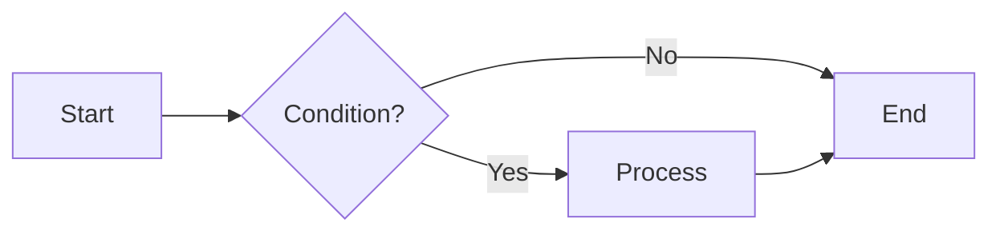

# VsMReader

> Lightweight Markdown reader / editor · Windows · macOS · Tauri 2 + Svelte 5 · [MIT License](./LICENSE)

[简体中文](README_CN.md) | **English**


VsMReader is a **only a few MB, installation-free, portable** Markdown tool for both **reading** and **editing**, with built-in syntax highlighting, math formulas, flowcharts, local image support, and a full set of anti-loss mechanisms.

## 👇 Download

Download the build for your platform from the Releases page — ready to run, no compilation needed. Either mirror works:

| Platform | File | Notes |
|----------|------|-------|
| Windows | `vsmreader.exe` | 🟢 Portable single file, double-click to run, no install |
| Windows | `VsMReader_0.1.0_x64-setup.exe` | NSIS installer |
| macOS | `VsMReader_0.1.0_x64.dmg` | Drag into Applications to install |

> Both mirrors host identical files — pick either one.
> - Users in China may prefer Gitee: [Gitee Releases](https://gitee.com/coolender/vs_md_tool/releases)
> - Overseas / macOS users may prefer GitHub: [GitHub Releases](https://github.com/coolender/vs_md_tool/releases)

> To make the portable Windows exe carry its data with it (USB-stick mode), create an empty `portable.txt` next to the exe.

---

## Build from source

Don't want the prebuilt binaries? You can compile it yourself.

### Requirements

- [Node.js](https://nodejs.org/) 18+ and pnpm
- [Rust](https://www.rust-lang.org/) stable toolchain
- Platform dependencies:
  - **Windows**: Visual Studio C++ Build Tools / WebView2
  - **macOS**: Xcode Command Line Tools (`xcode-select --install`)

### Local build

```bash
# 1. Install dependencies
pnpm install

# 2. Dev mode (hot reload)
pnpm tauri dev

# 3. Production build (produces exe / dmg / installer)
pnpm tauri build
```

Build artifacts are under `src-tauri/target/release/bundle/`.

> ⚠️ **Cross-platform build limitation**: Tauri can only build for the current OS — Windows produces `.exe`, macOS produces `.dmg`. For another platform's installer, build on that platform.

---

## User manual

### 1. Install & launch

#### Option A: Portable (recommended)

Take the `vsmreader.exe` single file, drop it anywhere, **double-click to run** — no installation.

- No registry writes, no system folders, no background process.
- To fully uninstall? Just delete the exe — clean.
- To carry "recent files", "window position", "settings" etc. along with the exe (USB-stick mode), create an empty `portable.txt` next to it — data will live in a `data/` folder beside the exe.

#### Option B: Installer

Run `VsMReader_0.1.0_x64-setup.exe`, follow the wizard (no admin rights needed), creates a Start Menu shortcut.

#### Make .md open with VsMReader by default (optional, Windows only)

1. Launch VsMReader, click the **`.md`** button on the right of the toolbar.
2. After the "registered .md association" prompt, set **double-click .md to open with VsMReader** via one of:
   - **Option 1 (recommended)**: Right-click any `.md` → Open with → Choose another app → pick VsMReader → check "Always use this app to open .md files".
   - **Option 2**: Settings → Apps → Default apps → Choose default apps by file type → find `.md` → pick VsMReader.
3. From now on double-clicking any `.md` opens it directly in VsMReader.

> Note: Windows 10/11 security prevents a program from directly grabbing "default app" status — you must confirm once in system settings. This is a Windows limitation, not a software issue. The `.md` button only registers VsMReader into the "Open with" list; the actual "default" still needs your manual check.
> To undo the association? Click the `.md` button again (it now shows `✓ .md`), confirm to revert.

---

### 2. Interface overview

```
┌──────────────────────────────────────────────────────────────────────┐
│ New Open▾ Save SaveAs Export ↶ ↷  filename.md ●  Split|Read|Edit ☾ En ⚙ .md │ ← Toolbar
├──────────────────────────────────────────────────────────────────────┤
│ Tab1 ●×  Tab2 ×  +  ▾                                              ⚠ │ ← Tab bar
├────────────┬─────────────────────────────────────────────────────────┤
│            │                                                       │
│ Outline/   │            Editor  /  Preview                         │
│ Files      │                                                       │
│            │                                                       │
├────────────┴─────────────────────────────────────────────────────────┤
│ 1,234 chars · 56 lines · ~5 min          C:\path\to\file.md   ← Status bar │
└──────────────────────────────────────────────────────────────────────┘
```

- **Toolbar**: New / Open (with recent files) / Save / Save As / Export HTML / Undo ↶ / Redo ↷ / current filename & modified mark (●) / three-mode switch / theme switch / language switch / Settings ⚙ / `.md` association.
- **Tab bar**: Multiple files open as independent tabs; the ▾ on the right is also the recent-files list; `+` creates a new tab.
- **Sidebar**: Two tabs — **Outline** (auto-extracted heading tree, click to jump) and **Files** (browse the current document's directory tree).
- **Main area**: Shows "editor + preview" or one of them, depending on the mode.
- **Status bar**: Char count / line count / reading time (click to toggle items), file path on the right; a red ⚠ appears on the left when auto-save fails.

---

### 3. Three modes

The top `[Split] [Read] [Edit]` switches instantly, preserving cursor and edit state.

| Mode | Description | Shortcut |
|------|-------------|----------|
| **Split** | Source on the left, live preview on the right | `Ctrl+\` |
| **Read** | Full-screen reading, hides the editor (default mode) | `Ctrl+Shift+\` |
| **Edit** | Full-screen editing, hides the preview | `Ctrl+\` (from Split) |

> In Split mode, editor and preview scroll in sync.
> **Each tab remembers its own mode**: tab A can be in Edit, tab B in Read — switching tabs restores each one's state.

---

### 4. File operations

| Operation | How | Shortcut |
|-----------|-----|----------|
| New | Toolbar "New" or tab bar `+` | `Ctrl+N` |
| Open | Toolbar "Open" | `Ctrl+O` |
| Open recent | The ▾ beside "Open", or the ▾ on the tab bar | — |
| Save | Toolbar "Save" | `Ctrl+S` |
| Save As | Toolbar "Save As" | `Ctrl+Shift+S` |
| Export HTML | Toolbar "Export" | `Ctrl+Shift+E` |
| Switch tab | Click tab / cycle | `Ctrl+Tab` / `Ctrl+Shift+Tab` |
| Close tab | The × on the tab | `Ctrl+W` |
| Toggle sidebar | — | `Ctrl+B` |

- **Double-click .md to open**: Once associated, double-clicking a `.md` opens it directly as a new tab in VsMReader; if VsMReader is already running, it brings the existing window to the front and opens the file (does not spawn a second window).

---

### 5. Editing: human-friendly features

VsMReader ships a full set of Markdown editing enhancements.

#### 5.1 Format shortcuts (select text, then press)

| Shortcut | Effect | Notes |
|----------|--------|-------|
| `Ctrl+B` | **bold** `**…**` | Press again to toggle off (idempotent) |
| `Ctrl+I` | *italic* `*…*` | Press again to toggle off |
| `` Ctrl+` `` | `inline code` | Press again to toggle off |
| `Ctrl+K` | Insert link | No selection: inserts `[](https://)` with cursor in `[]`; with selection: `[selected](https://)` with cursor on the URL |

> Key point: it **wraps the selection**, never replaces — so no characters are lost.

#### 5.2 Headings & structure

| Shortcut | Effect |
|----------|--------|
| `Ctrl+1` ~ `Ctrl+6` | Set as H1 ~ H6; if already at that level, removes the prefix |
| `Ctrl+8` | Insert horizontal rule `---` |
| `Ctrl+Shift+T` | Insert a 3×2 table template |
| `Ctrl+/` | Comment `<!-- … -->` (toggles correctly with/without selection, already-commented) |

#### 5.3 List auto-continuation

- Pressing **Enter** at the end of a `- ` / `* ` / `+ ` / `1. ` / `- [ ]` list item auto-continues with the same prefix.
- Task-list `[x]` auto-resets to `[ ]` on continuation.
- Ordered list `1.` becomes `2.`, `3.`… on continuation.
- **Empty item + Enter cancels the list** (drops the prefix → blank line), matching Typora/Notion behavior.

#### 5.4 Brackets & indentation

- **Auto-pairing**: typing `(` auto-completes `)`; selecting text and typing `(` wraps it as `(text)`; quotes behave the same.
- **Pair highlighting**: when the cursor is beside a bracket, the matching half is highlighted.
- `Tab` indent, `Shift+Tab` outdent (inside lists, creates nested sub-items).

#### 5.5 Line operations

| Shortcut | Effect |
|----------|--------|
| `Alt+↑` / `Alt+↓` | Move current line(s) up / down |
| `Shift+Alt+↑` / `Shift+Alt+↓` | Duplicate current line up / down |
| `Ctrl+D` | Delete current line |

#### 5.6 Drag & paste

- **Drop an image** into the editor → auto-inserts ``.
- **Drop a normal file** → auto-inserts `[filename](path)`.
- **Paste a URL as a link**: select text, paste an `http(s)://` URL → becomes `[selected text](url)`; with no selection, normal paste.
- **Paste an image**: when the clipboard is an image, saves it to `images/` beside the document and inserts ``.

#### 5.7 Undo / redo / find

- Toolbar **↶ / ↷** buttons for undo / redo; the disabled state reflects whether undo/redo is available; shortcuts `Ctrl+Z` / `Ctrl+Y`.
- `Ctrl+F` opens the find bar (built into CodeMirror), supports regex, case-sensitive, whole-word.

---

### 6. Rendering

#### 6.1 Syntax highlighting

Code blocks use **Shiki** (the same engine as VS Code), supporting 20+ common languages: JavaScript / TypeScript / Python / Rust / Go / Java / C / C++ / C# / PHP / Ruby / SQL / JSON / YAML / HTML / CSS / Bash / Markdown / Shell / Docker / Diff, etc. The theme auto-switches with the app's light/dark mode.

#### 6.2 Math formulas (KaTeX)

- Inline: `$E=mc^2$`
- Block: `$$\int_0^1 x\,dx = \frac12$$`

#### 6.3 Flowcharts (Mermaid)

Use a ` ```mermaid ` code block, e.g.:

````markdown

````

Mermaid is lazy-loaded only when the document contains such a code block, so it doesn't slow first paint. The theme follows the app's light/dark mode. On render failure, the original source and an error hint are shown for troubleshooting.

#### 6.4 Local images

Supports local image paths without manual protocol conversion:

- Absolute path: ``
- Relative path: `` (resolved relative to the current document's directory)

VsMReader auto-converts local paths into loadable internal-protocol URLs; images display directly in the preview.

#### 6.5 Task lists

`- [ ]` unchecked, `- [x]` checked — rendered as readable checkbox style.

#### 6.6 Export HTML

`Ctrl+Shift+E` or the toolbar "Export" button renders the current document into a **standalone, shareable HTML file**: inlined CSS (with light/dark theme variables, prose typography, KaTeX styles), code highlighting with inlined styles, Mermaid exported as inline SVG. Opens and views without any dependency.

---

### 7. Anti-loss mechanisms (key)

VsMReader is built around "never lose content while editing".

#### 7.1 Per-tab independent edit history

- Switching tabs **does not pollute the undo stack**: each tab retains its own undo/redo history, cursor, scroll position.
- Switching back, Ctrl+Z only undoes that tab's own changes — no bleed into other tabs.

#### 7.2 Auto-save (throttled, not debounced)

- Saves **after a delay** following edits (default 5 minutes, adjustable 1 second ~ 10 minutes in settings).
- **Timer anchored to "the most recent save"** (auto or manual, whichever is later) — not to the last keystroke — so continuous typing still triggers a save at each interval (throttle semantics), never stuck because you keep typing.
- **Named files**: written back to the original path; on success, the dirty mark is cleared.
- **Untitled tabs** (never-saved new documents): auto-saved as **drafts** to `drafts/` under the data directory; dirty mark stays (for crash recovery).
- Manual save (`Ctrl+S`) resets the auto-save timer to avoid "just manually saved then immediately auto-saved again".

#### 7.3 Drafts & crash recovery

- Untitled tabs are periodically saved as drafts — **even without manual save or Save-As, content is not lost**.
- On startup, if drafts are detected (previous crash / unclean close), they're **silently restored** as dirty tabs (●) — you can save or close them.
- When an untitled tab is **Save-As'd to a real file**, the corresponding draft is auto-deleted.
- When a tab is explicitly closed (`Ctrl+W` confirmed), the draft is also deleted (user chose to discard).

#### 7.4 Save-failure notification

- When auto-save fails, a **red ⚠ appears on the left of the status bar and in the toolbar**; hover for the error message — no more silent failures.

#### 7.5 External file-change detection

- Polls named files' modification time every 2 seconds; if the on-disk version was changed by an external program:
  - Memory not dirty (you didn't edit) → auto-reload the disk content.
  - Memory dirty (you're editing) → prompt, you decide whether to discard local edits and reload.
- The program's own write actions have a 4-second suppression window — won't be misdetected as "external change" causing repeated prompts or scroll jumps.

#### 7.6 Close protection

- On window close, if there are unsaved tabs, a **three-way** prompt appears:
  - **Save and close**: named files written back; untitled tabs skipped (drafts are the fallback).
  - **Don't save**: close directly (untitled tabs recoverable from drafts).
  - **Cancel**: stay in edit.
- Closing a single tab with unsaved changes also confirms once.

---

### 8. Sidebar: outline & file tree

#### 8.1 Outline

- Auto-extracts the heading tree from the document, indented by level.
- **Click any heading to jump**: in Edit/Split mode, jumps to the corresponding source line; in Read mode, scrolls to the position.
- **Scroll-linked highlight**: while reading/editing, the sidebar outline highlights the heading for the visible region (IntersectionObserver + editor viewport detection).

#### 8.2 File tree

- Browse the file list of the current document's directory; clicking a `.md` opens it in a new tab.
- Navigate up to parent dirs and down into subdirs.

#### 8.3 Favorites (bookmarks)

- The toolbar's bookmark button **favorites the current document**, with grouping support.
- Favorites persist across sessions; filterable by name/path.

---

### 9. Theme & typography

- Toolbar ☾/☀/◐ icons switch **dark / light / follow-system**.
- Code highlighting and Mermaid diagrams follow the theme.
- **Settings → Reading-area typography** lets you customize: font stack, font size, line height, max width, custom CSS (injected globally, can override any style).

---

### 10. Chinese / English UI

- Toolbar **中 / En** button toggles the UI language instantly, or pick in settings.
- Switch takes effect immediately, no restart.

---

### 11. Link-click behavior

When clicking a link in the **read/preview area**:

- **External links** (http/https/mailto, etc.) → opened with the **system default browser**, not in-app (which would blank-screen).
- **In-document anchors** (`#heading`) → scroll to the heading.

---

### 12. Shortcut cheat sheet

| Shortcut | Function |
|----------|----------|
| `Ctrl+N` | New |
| `Ctrl+O` | Open |
| `Ctrl+S` | Save |
| `Ctrl+Shift+S` | Save As |
| `Ctrl+Shift+E` | Export HTML |
| `Ctrl+Z` / `Ctrl+Y` | Undo / Redo |
| `Ctrl+W` | Close current tab |
| `Ctrl+Tab` / `Ctrl+Shift+Tab` | Switch tab |
| `Ctrl+\` | Split ↔ Edit |
| `Ctrl+Shift+\` | Split ↔ Read |
| `Ctrl+B` | Toggle sidebar / Bold (in editor) |
| `Ctrl+I` | Italic |
| `` Ctrl+` `` | Inline code |
| `Ctrl+K` | Insert link |
| `Ctrl+1`~`Ctrl+6` | Heading H1~H6 |
| `Ctrl+8` | Horizontal rule |
| `Ctrl+Shift+T` | Table template |
| `Ctrl+/` | Comment |
| `Ctrl+D` | Delete current line |
| `Alt+↑`/`Alt+↓` | Move line |
| `Shift+Alt+↑`/`Shift+Alt+↓` | Duplicate line |
| `Tab` / `Shift+Tab` | Indent / Outdent |
| `Ctrl+F` | Find |

> On macOS, `Ctrl` corresponds to `Cmd`.

---

### 13. FAQ

**Q: Double-click .md doesn't work?**
A: On Windows, first click the `.md` button in VsMReader to register the association, then check "Always use VsMReader to open .md" once in system "Open with" (see Section 1). On macOS, installing the `.dmg` makes double-clicking `.md` use the system file association — no button needed.

**Q: Where does the portable version store its data?**
A: Windows default is `%APPDATA%\com.vsmreader.app\` (settings `settings.json`, theme prefs `themeprefs.json`, bookmarks `bookmarks.json`, drafts `drafts/`); macOS is `~/Library/Application Support/com.vsmreader.app/`. If a `portable.txt` exists next to the exe, data goes in a `data/` folder beside the exe — good for USB sticks (Windows portable only).

**Q: Images don't show?**
A: Check the path. Relative paths are relative to the `.md` file's directory. Absolute paths work with either backslash or forward slash.

**Q: Mermaid diagrams don't show?**
A: Check that the code-block language is `mermaid` and the syntax is correct. On render failure, an error hint and the original source are shown.

**Q: Does undo history bleed across tabs?**
A: No. Each tab has an independent edit-state cache — saved on switch-away, restored on switch-back. Ctrl+Z only undoes the current tab's changes.

**Q: Can an untitled document be recovered after a crash?**
A: Yes. Untitled tabs are auto-saved as drafts; restarting VsMReader silently restores them as dirty tabs.

**Q: Does auto-save interrupt typing?**
A: Auto-save is throttled (once per interval), not on every keystroke; default 5 minutes, adjustable 1 second ~ 10 minutes in settings. Saving runs in the background and doesn't grab focus.

**Q: Laggy on large files?**
A: Very large files (>100KB) render slowly in real time — switch to "Edit" mode to focus on writing, then switch back to Split preview.

---

### 14. Tech stack

- **Frontend**: Svelte 5 + TypeScript + Vite, CodeMirror 6 editor, markdown-it + Shiki + KaTeX + Mermaid rendering.
- **Backend**: Tauri 2 (Rust): single instance, window-state memory, file association, local file I/O.
- **Build**: `pnpm tauri build` produces Windows (portable exe + NSIS installer) and macOS (dmg).

---

### 15. Release process

This project ships prebuilt binaries via Releases:

1. Run `pnpm tauri build` on the target platform:
   - On Windows: produces `src-tauri/target/release/vsmreader.exe` (portable) and `bundle/nsis/VsMReader_0.1.0_x64-setup.exe` (installer).
   - On macOS: produces `bundle/dmg/VsMReader_0.1.0_x64.dmg`.
2. **Create a Release** in the repo, fill in the version and changelog, upload the above artifacts as attachments.
3. Users download the file for their platform from the Releases page — no compilation needed.

---

## License

[MIT License](./LICENSE) — free to use, modify, and distribute.
